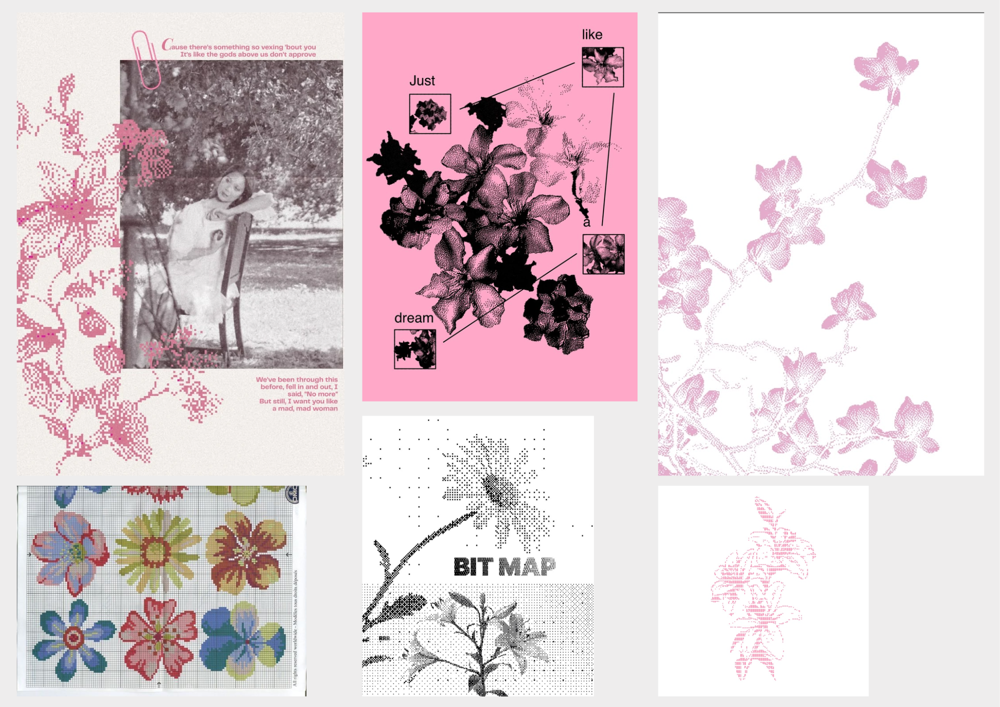
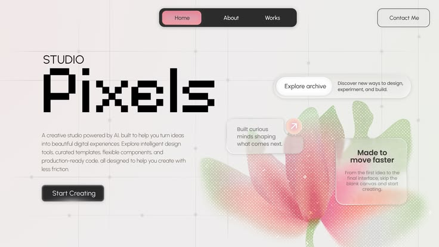
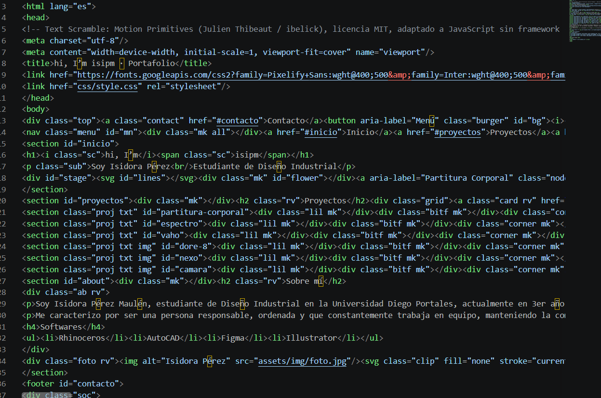

# Portafolio

> Conceptos. Explica con tus palabras qué es cada uno, para qué lo usaste y muestra un fragmento de tu propio código: HTML, CSS, JavaScript, MQTT y otros que estimes convenientes (por ejemplo React, GitHub Pages, API, Web Audio o MediaPipe).

## Descripción del proyecto

Portafolio **Hi, I’m isipm** es un proyecto de diseño y desarrollo web el cual nace para construir un espacio digital, el cual expresa mi identidad como diseñadora en base a los conocimientos, experiencias y proyectos que he desarrollado a lo largo de mi formación académica. La propuesta se basa en pasar de un portafolio común a una experiencia visual interactiva, en donde la identidad visual, programación y diseño de interfaz son un todo y se complementan.

El proyecto parte desde un boceto inicial en Figma, posteriormente materializada con HTML, CSS y JavaScript. Permitiendo la visualización tanto en mobile como desktop. Las áreas las cuales se trabajaron durante este proyecto a implementar son: composición gráfica, jerarquización, navegación, animaciones e interacciones y la forma de adaptación de los contenidos en diferentes formatos de pantalla [diseño responsivo].

## Decisiones diseño

La identidad visual del portafolio se construye a partir de elementos botánicos, específicamente flores, formas orgánicas y gráficas pixeladas, generando contraste entre lo natural y lo computacional. Utilizando una paleta cromática compuesta principalmente por tonalidad rosadas, verde oliva y un fondo crema y neutro, donde todo resalta con más detalle. La acompañan las tipografía Poppins y Pixelify Sans, las cuales permiten establecer diferentes jerarquías y personalidad a lo largo del portafolio. Por último, las flores funcionan como un recurso gráfico, un complemento el cual proporciona continuidad visual a lo largo de la página

## GitHub personal

Este es mi GitHub personal, el cual lo inicié a principios de semestre para el ramo, donde funciona como bitácora de apuntes de forma semanal y para respaldar los encargos de cada clase.

[GitHub](https://github.com/isipm08/dis9087-dppi)

## Landing

En landing tenemos la gráfica principal que destaca todo el proyecto, la flor interactiva que presenta estos 3 proyectos bases que he realizado a lo largo de la asignatura y 3 proyectos personales que he realizado a lo largo de la carrera, a través de líneas que conectan todos estos, la cual se va transformando mediante el scroll del usuario hacia abajo. Además se incorpora una bienvenida, presentándome de manera acotada mi nombre y lo que estudio actualmente. Esta interacción propone una nueva alternativa para explorar el contenido

El componente incorporado en mi portafolio es ```Text Scramble, de Motion Primitives```. Lo que realiza es que al momento de iniciar la página o pasar el cursor sobre el título "Hi, I´m isipm" estas pasan por una secuencia de letras al azar antes de asentarse en su forma final. También se activa en los títulos de sección (Proyectos, Sobre mí) al aparecer en pantalla.

> Licencia: la ficha en 21st.dev lo lista como MIT, que permite usarlo y adaptarlo.

## Proyectos

La organización de los proyectos se inspira en el concepto de carpetas digitales, reinterpretando elementos propios de las interfaces computacionales. Cada carpeta permite acceder a una sección individual, en la que se profundiza sobre el proyecto mediante descripciones, fotografías, videos y registros de sus procesos de desarrollo. Esta estructura permite reunir trabajos de distintas áreas del diseño, desde la experimentación material y la fabricación de objetos hasta la representación gráfica, la programación y las máquinas computacionales.

Los proyectos que se presentan en el portafolio son:

```1. Partitura Corporal```
- Descripción proyecto: Proyecto desarrollado durante el segundo semestre de 2026 en el curso DPPI, que explora la relación entre el cuerpo, el movimiento y la visión artificial. Mediante HTML, CSS, JavaScript y el uso de MediaPipe y OpenCV.js, se crea una experiencia audiovisual interactiva en la que los movimientos de las manos, captados por una cámara, modifican la intensidad del sonido y los estímulos visuales, convirtiendo el cuerpo en una interfaz de interacción digital.
- Link repositorio: [Partitura corporal](https://github.com/isipm08/partitura-corporal)
- Link experiencia: [Partitura corporal](https://isipm08.github.io/partitura-corporal/)
  
```2. Espectro```
- Descripción proyecto: Proyecto desarrollado durante el segundo semestre de 2026 en el curso DPPI, que explora la relación entre lo emocional, lo visual y lo sonoro. Mediante HTML, CSS, JavaScript y las bibliotecas face-api.js y Tone.js, se desarrolla una plataforma interactiva que traduce las expresiones faciales en colores y composiciones sonoras en tiempo real, utilizando la visión artificial y la síntesis de sonido como herramientas de experimentación audiovisual.
- Link repositorio: [Espectro](https://github.com/isipm08/espectro)
- Link experiencia: [Espectro](https://isipm08.github.io/espectro/)
  
```3. Vaho```
- Descripción proyecto: Proyecto desarrollado durante el segundo semestre de 2026 en el curso DPPI, interactivo e inspirado en el recuerdo de dibujar sobre una ventana empañada durante un día de lluvia. Desarrollado mediante HTML, CSS, JavaScript y el protocolo MQTT, utiliza el teléfono móvil como interfaz táctil para descubrir un paisaje y recorrer una aventura de estética pixel art. Se explora la relación entre el tacto, la imagen y el sonido, transformando un gesto cotidiano en una experiencia lúdica, sensorial y narrativa.
- Link repositorio: [Vaho](https://github.com/isipm08/vaho)
- Link experiencia: [Vaho](https://isipm08.github.io/vaho/)

 ```4. Dore-8```
 - Descripción proyecto: Proyecto desarrollado durante el segundo semestre de 2026 en el ramo de Taller Vertical: Máquinas Computacionales. Consiste en el diseño y desarrollo de un dispositivo interactivo inspirado en la computación retro, utilizando una Raspberry Pi Pico 2W y programación en C++ para integrar componentes electrónicos y generar una experiencia de interacción digital.

 ```5. Nexo```
- Descripción proyecto: Proyecto desarrollado durante el segundo semestre de 2025 en el ramo de Prototipos. Consiste en el diseño y fabricación de un velador que combina madera y una estructura metálica, explorando técnicas de corte, ensamblaje y terminaciones para crear un mobiliario funcional de estética contemporánea.
  
  ```6. Cámara```
- Descripción proyecto: Proyecto desarrollado durante el primer semestre de 2024 en el ramo de Geometría Básica. Consiste en la construcción de una cámara Polaroid a escala, utilizando cartón y planos elaborados manualmente, explorando la representación tridimensional, las proporciones y las técnicas de construcción de modelos físicos.

## About me

El apartado de about me tiene una breve descripción de mis habilidades personales en el ámbito de la carrera, además de características que me destacan como persona al momento de trabajar y desempeñarme en diferentes áreas de trabajo.

Soy Isidora Pérez Maulén, estudiante de Diseño Industrial en la Universidad Diego Portales, actualmente en 3er año de la carrera. Me concentro en habilidades manuales en el ámbito de la madera, realización de planos tanto de forma digital como análoga, desarrollo de páginas webs mediante Figma, HTML, CSS y JS. Realización de máquinas computacionales mediante código C++.

Me caracterizo por ser una persona responsable, ordenada y que constantemente trabaja en equipo, manteniendo la comunicación y el desarrollo de nuevas habilidades para mi crecimiento personal.

Softwares
Rhinoceros
AutoCAD
Figma
Illustrator

> En el apartado contacto podemos encontrar mi GitHub, Instagram y redireccionar a correo.

## Referentes

La mayoría de mis referentes fueron sacados de Pinterest, los cuales rescaté el tema más visual de mi página web. 

Lo que quería transmitir con estos referentes es el uso de elementos gráficos orgánicos y naturales como lo son las flores, con la mezcla de tipografías y elementos gráficos estilo pixel, para así generar un complemento entre ambos.



**referente 2**

https://www.awwwards.com/websites/interaction-design/

- Web donde encontré páginas web interactivas bastante útiles e inspiracionales, me sirvió de igual forma para ir viendo la estética y ciertos tipos de diagramación.

**referente 3**



Studio pixels

Esta home de página web combina la estética computacional con elementos orgánicos, utilizando degradados, tipografía pixelada, grilla visible y leves transparencias.

1. A simple vista se ve de que la página trata de un estudio creativo relacionado con el diseño digital, tecnología e inteligencia artificial. La estética combina referencias computacionales y recursos gráficos enfocados en lo orgánico.
2. Visualmente se distinguen dos tipos de tipografías [pixelada, sans serif]. El uso de solo dos tipografías permite una jerarquía clara sin recurrir a muchas tipografías.
3. La grilla está presente en la página web, una grilla modular visible, conformada por líneas horizontales, verticales y algunos puntos de intersección. Dividiéndose en dos grandes zonas como lo son lo textual y gráfica. Se repiten las esquinas redondeadas, transparencias, elementos gráficos pixelados, grilla. La flor que se presenta de gran tamaño sobrepasa los límites de la grilla, también hay tarjetas las cuales se superponen a la imagen, generando niveles de profundidad. Contraste entre el orden de lo geométrico de la interfaz y las formas naturales.
4. Según lo que se ve a simple vista, la página cuenta con una barra de navegación con las categorías de Home, About y Works, incorpora botón que invita al usuario a explorar más a fondo el contenido del estudio.
5. Solo se presenta la imagen estática en este referente, pero hay ciertos elementos gráficos dentro de este que pueden indicar alguna posibilidad de movimiento o interacción.
6. En la interfaz al principio, el texto es el que tiene mayor predominancia y jerarquía visual, destacando por su tamaño, peso y contraste. Luego la mirada inmediatamente se dirige a la flor pixelada, como el primer elemento gráfico que encontramos. 

Relación
- Este referente tiene relación con mi portafolio principalmente por la combinación entre los elementos orgánicos y computacionales dentro de la misma identidad visual, generando así un contraste y un equilibrio entre ambos. Permitiendo generar una identidad vinculada a la naturaleza con el uso de un lenguaje digital. Además utiliza una grilla como base, en donde incorporo elementos gráficos que rompen esa estructura establecida. A partir del análisis de este referente, rescato el uso de las flores no solo como un elemento gráfico decorativo, si no como un recurso para poder construir una identidad visual.

**referente 4**

Web: https://andreas.vision/

Autor: Andreas Kruszakin

1. Combina diseño, programación, desarrollo productos digitales. Comunica resolución problemas, funcionalidad y resultados. Acá busca más comunicar su valor que aporta mediante su trabajo, más que el portafolio en sí.
2. La jerarquía del proyecto se basa en los niveles de información los cuales entrega, diferenciar título, subtítulos, descripciones y los componentes de navegación.
3. Agrupa la información en bloques o secciones. Se repite la estructura en la cual presenta sus proyectos, relación títulos, descripciones, elementos navegación. Lo que no sigue la regla son las visualizaciones interactivas, uso de diagramas y registros del proceso.
4. Se accede seleccionando un proyecto mediante su título, en donde se accede a una página enfocada solo al proyecto seleccionado.
5. Los conceptos de movimiento e interacción en esta página son formas de comunicación de los proyectos y los procesos que los componen. El movimiento en este caso también cumple una función demostrativa e informativa.
6. El texto aquí es el que se visualiza primero en la estructura del contenido

Relación
- En relación con mi portafolio, el referente que escogí me resulta relevante por la implementación de los elementos interactivos y la navegación que tiene hacia los proyectos individuales. De igual forma mi portafolio busca una identidad más experimental que profesional mediante los elementos botánicos, gráficas pixeladas, carpetas digitales y composiciones orgánicas. Finalmente rescato la coherencia entre páginas y la utilización de las interacciones con una intención en particular, procurando así que la experiencia visual no sea un impedimento en la navegación del sitio.

## Código

Acá se ve un poco la visualización del HTML, este es bastante simple, ya que es el encargado de integrar la tipografía y definir los proyectos que seleccioné para el portafolio.



## Uso IA

En este documento se muestra a más profundidad el uso de inteligencia artificial durante el proyecto.

[Documentación uso IA](https://docs.google.com/document/d/1TndBwrkme2uqBAAmZxu647Skwt5mFbfC2Et82HoxVkE/edit?usp=sharing)

## Reflexión

> Reflexión del semestre. Tus principales aprendizajes, los desafíos que enfrentaste y cómo los resolviste, los créditos (código, componentes, tipografías, imágenes y sonidos de terceros, con autor, fuente y licencia) y tu uso de IA a lo largo del semestre. Esta reflexión la escribes tú, con tus palabras y sin usar IA para redactarla.
